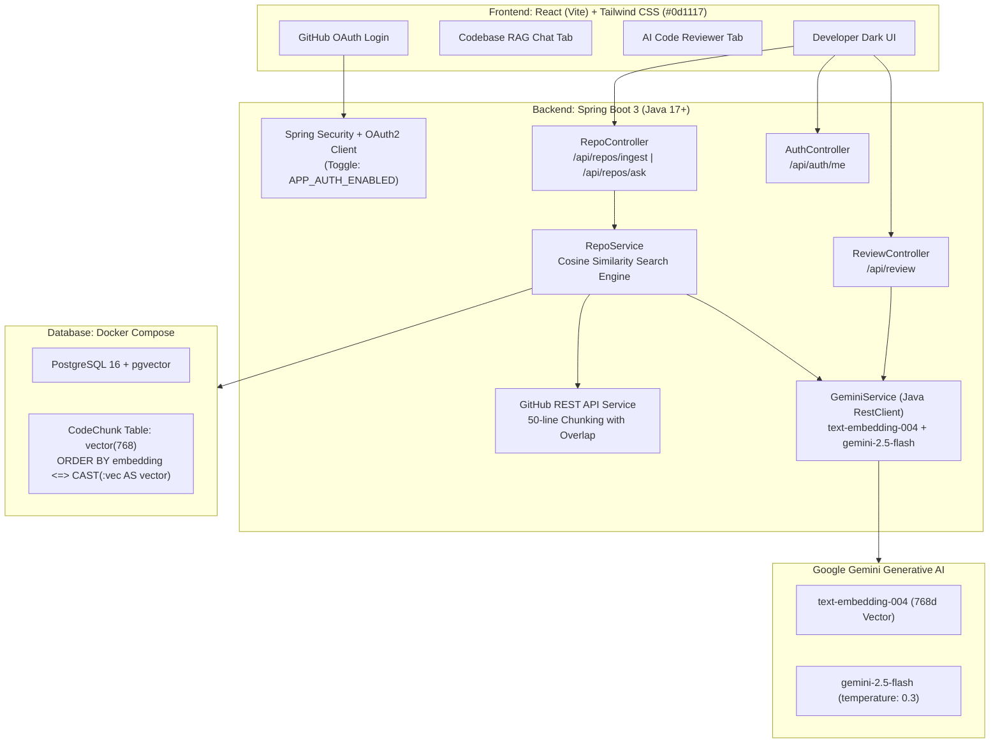

# Repo Sage 🧙‍♂️ — Full-Stack Codebase Intelligence, RAG & AI Code Review

> **Enterprise-grade Developer Workspace** combining **Java 17+ / Spring Boot 3**, **PostgreSQL with pgvector**, **Google Gemini 2.5 Flash**, **GitHub OAuth 2.0**, and **React (Vite) + Tailwind CSS**.


-a371f7?style=flat-square)


---

## 🚀 Quickstart: Exact 3-Step Startup Commands

### Step 1: Start PostgreSQL with pgvector
From the project root:
```bash
docker compose up -d
```
> Initializes PostgreSQL 16 on port `5432` with automated `pg_isready` healthcheck, persistent named volume (`pgdata`), and auto-enables the `vector` extension via `init.sql`.

---

### Step 2: Start Spring Boot Backend
Navigate to `backend/` and start the server:
```bash
# On Linux / macOS:
./mvnw spring-boot:run

# On Windows:
mvnw.cmd spring-boot:run
```
> Boots Spring Boot 3 on `http://localhost:8080`. Hibernate automatically updates schema tables (`code_chunks`) with `vector(768)` columns.

---

### Step 3: Start React Frontend
In a new terminal, navigate to `frontend/`:
```bash
npm run dev
```
> Launches the developer workspace at `http://localhost:5173` with proxying to backend `/api`.

---

## 🏗️ Architecture & Tech Stack



### Key Technical Components:
* **Java 17+ / Spring Boot 3**: High-performance enterprise backend using `RestClient`, Spring Data JPA, and Spring Security.
* **PostgreSQL + pgvector**: Vector database storing 768-dimensional embeddings generated from repository code chunks. Cosine distance operator (`<=>`) executes semantic vector similarity search.
* **Google Gemini API**:
  * `text-embedding-004`: Generates 768-dimensional dense vector embeddings for code chunks and user questions.
  * `gemini-2.5-flash`: Operates at temperature `0.3` for grounded RAG codebase answers and structured 4-part code reviews.
* **GitHub OAuth 2.0 & Demo Toggle**:
  * Configured via `spring-boot-starter-oauth2-client` redirecting to `http://localhost:5173`.
  * `APP_AUTH_ENABLED=false` enables **Demo Mode** with a Guest profile, allowing interviews and demonstrations without mandatory OAuth configuration.
* **React + Vite + Tailwind CSS**:
  * Dark developer aesthetic (`#0d1117` GitHub dark mode palette).
  * `react-simple-code-editor` + `prismjs` for syntax-highlighted code inspection.
  * `react-markdown` for formatted RAG explanations and code review reports.

---

## ⚙️ Configuration & Environment Variables

Copy `backend/.env.example` to `backend/.env` (or pass via system environment):

```env
# PostgreSQL Configuration
SPRING_DATASOURCE_URL=jdbc:postgresql://localhost:5432/reposage?stringtype=unspecified
SPRING_DATASOURCE_USERNAME=postgres
SPRING_DATASOURCE_PASSWORD=postgres

# Google Gemini API
GEMINI_API_KEY=your_gemini_api_key_here
GEMINI_MODEL=gemini-2.5-flash
GEMINI_EMBEDDING_MODEL=text-embedding-004

# GitHub OAuth 2.0 (Set to true to require GitHub login)
APP_AUTH_ENABLED=false
GITHUB_CLIENT_ID=your_github_client_id
GITHUB_CLIENT_SECRET=your_github_client_secret

# Frontend URL
FRONTEND_URL=http://localhost:5173
```

> **Demo-Friendly Note:** If `GEMINI_API_KEY` is not provided, the application runs in intelligent demo fallback mode, ensuring zero crashes while demonstrating the complete end-to-end vector search, chunking, and UI workflows.

---

## 📡 REST API Reference

### 1. Authentication
* `GET /api/auth/me`
  * Returns authenticated user profile or guest user when `APP_AUTH_ENABLED=false`.
  * Response: `{ authenticated: true, demoMode: true, username: "guest-developer", name: "Demo Engineer", avatarUrl: "..." }`

### 2. Codebase Ingestion
* `POST /api/repos/ingest`
  * Ingests a public GitHub repo or pasted code snippet, chunks into ~50 lines with overlap, computes 768d Gemini embeddings, and saves to pgvector.
  * Payload:
    ```json
    { "repoUrl": "https://github.com/spring-projects/spring-petclinic" }
    ```
    *or*
    ```json
    {
      "repoName": "order-service",
      "filePath": "OrderService.java",
      "code": "..."
    }
    ```
  * Response: `{ success: true, repoName: "...", filesIndexed: 4, chunksIndexed: 16 }`

### 3. Codebase RAG Q&A
* `POST /api/repos/ask`
  * Embeds user question, queries pgvector top-5 cosine similarity matches, and synthesizes an answer grounded in source files.
  * Payload:
    ```json
    { "repoName": "order-service", "question": "How are customer orders retrieved and validated?" }
    ```
  * Response:
    ```json
    {
      "answer": "Markdown formatted explanation with class and method citations...",
      "sources": [
        { "id": 1, "repoName": "order-service", "filePath": "OrderService.java", "snippet": "..." }
      ]
    }
    ```

### 4. AI Code Review
* `POST /api/review`
  * Submits code to Gemini 2.5 Flash for structured evaluation.
  * Payload:
    ```json
    { "code": "...", "language": "java" }
    ```
  * Response includes 4 structured Markdown sections:
    1. **Overview & Score** (Quality rating out of 10)
    2. **Bugs & Edge Cases** (N+1 queries, NullPointerExceptions, thread safety)
    3. **Time & Space Complexity** (Current vs optimal analysis)
    4. **Refactored Code** (Clean production-grade refactor)

### 5. Repository Management
* `GET /api/repos`: Lists all indexed repositories and their vector chunk counts.
* `DELETE /api/repos/{repoName}`: Deletes all chunks for the given repository.

---

## 🧪 Interview Demo Walkthrough

1. **Ingest a Repository**:
   - In **Codebase RAG Chat**, click one of the preset repos (e.g. *Spring PetClinic*) or paste a snippet.
   - Click **"Embed & Index into pgvector"**. Watch the chunk counter update in real-time.
2. **Ask Architectural Questions**:
   - Ask: *"Explain the domain models and entity relationships."*
   - Observe the expandable **"Retrieved Context Chunks"** badges showing the exact source files found via vector similarity search.
   - Click any badge to view the full chunk modal and line numbers.
3. **Run AI Code Review**:
   - Switch to **AI Code Reviewer** tab.
   - The editor is pre-loaded with a Spring Boot service method containing an N+1 query and null-pointer bug.
   - Click **"Review Code with Gemini"** to view structured findings, complexity analysis, and refactored code.

---

## 🛠️ Project Structure

```
RepoSage-devpilot/
├── docker-compose.yml             # PostgreSQL 16 pgvector service on port 5432
├── init.sql                       # Enables vector extension automatically
├── README.md                      # Documentation & startup instructions
├── backend/                       # Spring Boot 3 Java Maven project
│   ├── pom.xml                    # Spring Boot 3.3.5, pgvector, PostgreSQL, Security
│   ├── mvnw & mvnw.cmd            # Maven Wrapper
│   ├── .env.example               # Template environment configuration
│   └── src/
│       ├── main/java/com/reposage/
│       │   ├── RepoSageApplication.java
│       │   ├── config/            # SecurityConfig, CorsConfig, PgVectorConverter
│       │   ├── controller/        # AuthController, RepoController, ReviewController
│       │   ├── dto/               # Ingest, Ask, Review, UserProfile DTOs
│       │   ├── entity/            # CodeChunk JPA entity with vector(768)
│       │   ├── repository/        # CodeChunkRepository with native <=> vector query
│       │   └── service/           # GeminiService, GitHubService, RepoService
│       └── main/resources/
│           └── application.yml    # Datasource, OAuth2, and Gemini configuration
└── frontend/                      # React (Vite) + Tailwind CSS application
    ├── package.json               # react, lucide-react, react-markdown, prismjs
    ├── vite.config.js             # Vite build & API reverse proxy configuration
    ├── tailwind.config.js         # Dark mode theme & GitHub #0d1117 palette
    ├── index.html                 # App shell
    └── src/
        ├── components/
        │   ├── Navbar.jsx         # Header branding, tabs, and GitHub OAuth profile
        │   ├── CodebaseChat.jsx   # Ingestion sidebar, RAG chat, and chunk badges
        │   ├── CodeReviewer.jsx   # Split-screen editor and structured review output
        │   └── ContextChunkModal.jsx # Full chunk inspection modal
        ├── services/api.js        # REST API client
        ├── App.jsx                # Tab navigation & user state
        ├── index.css              # Custom scrollbars & markdown typography
        └── main.jsx               # React entrypoint
```

---

## 📄 License
MIT License. Built for modern software engineering teams and interview demonstrations.

